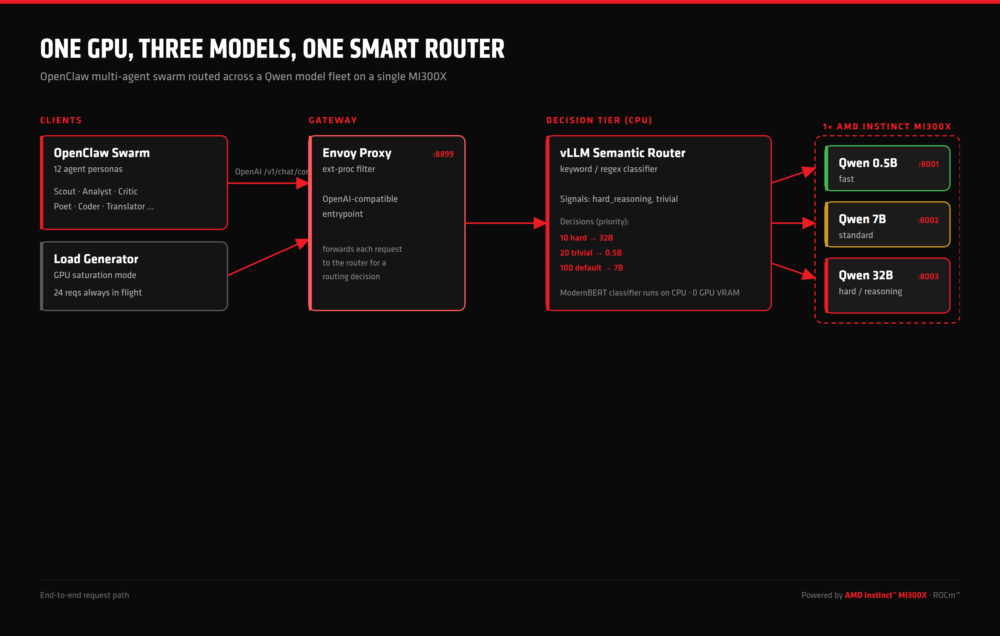
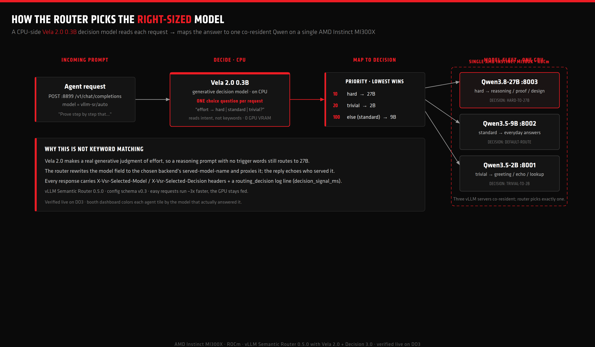
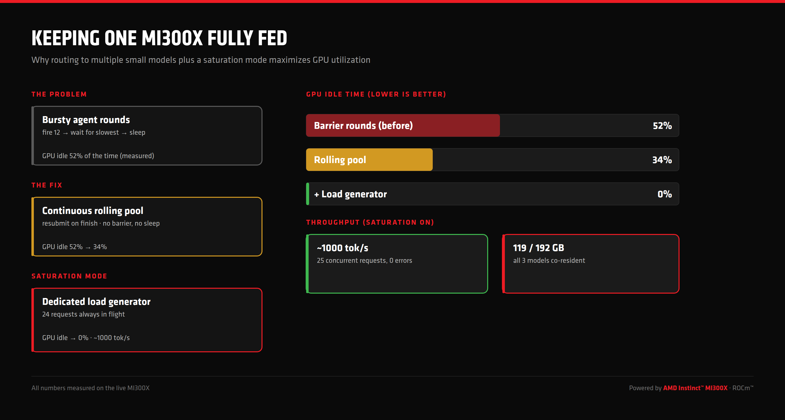

# OpenClaw multi-agent swarm, routed across a Qwen model fleet on one AMD Instinct MI300X

**Author: Shailen Sobhee**

A live booth demo (AMD ai-Pulse 2026, Paris) showing that **[OpenClaw](https://openclaw.ai) multi-agent workflows run great on local models**, served by **[vLLM](https://github.com/vllm-project/vllm)** on a single **AMD Instinct&trade; MI300X** with **ROCm&trade;**, and made efficient by the **[vLLM Semantic Router](https://github.com/vllm-project/semantic-router)**.

Instead of one big model answering everything, a small CPU-side **decision model** (**Vela 2.0 0.3B**) reads each request and routes it to the **right-sized** model: trivial turns go to a 2B, standard turns to a 9B, and genuine reasoning to a 27B. All three models are **co-resident on one GPU**, so easy requests run ~3x faster and the GPU stays fed.



## Why this is interesting

- **One GPU, three models.** Qwen3.5 `2B` + Qwen3.5 `9B` + Qwen3.8 `27B` share a single MI300X (measured 131 GB / 192 GB VRAM). No second card, no cloud fallback.
- **Smart routing, not a static pin.** The **Vela 2.0 0.3B** decision model runs on the **CPU** inside the router: **zero GPU VRAM** cost. It makes a real generative judgment per request (not a keyword match) and sends each agent turn to the cheapest model that can handle it.
- **Real multi-agent speedup.** A 12-persona OpenClaw swarm fans out across the fleet; trivial agent turns hit the 2B at ~61 tok/s instead of paying for the big model.
- **See the routing, per agent.** Each agent tile is bordered by the color of the model that actually answered it (2B amber, 9B AMD red, 27B magenta), so the live routing is visible at a glance. The model is captured honestly from the router's `X-Vsr-Selected-Model` header via a small tap proxy (`swarm/model_tap.py`); OpenClaw masks the served model as the `vllm-sr/auto` alias, and re-probing would mis-report because its large system scaffold changes routing.
- **The GPU stays busy.** A continuous rolling swarm plus an optional saturation load generator push GPU idle time from a measured **52% down to 0%** at ~**1000 tok/s**.
- **Everything is real.** No simulation. If a backend is down, the dashboard says so. Every number in these docs was measured on the live MI300X.

## How the routing works



The router sits in front of the vLLM backends on an **OpenAI-compatible** endpoint (`:8899`), with the **Vela 2.0 0.3B** decision model as its brain. For every request:

1. **Decide (CPU).** The router asks Vela 2.0 one `choice` question about the request: is the reasoning effort needed **hard**, **standard**, or **trivial**? This is a real generative judgment by a 0.3B model running on the CPU, so it costs **zero GPU VRAM**. Vela 2.0 reads intent, not surface keywords, so a reasoning prompt with no trigger words still routes correctly.
2. **Map the answer to a backend (priority order, lowest number wins).**

   | Priority | Vela 2.0 answer | Routed to |
   |---:|---|---|
   | `10` | `hard` | **Qwen3.8-27B** (`:8003`) |
   | `20` | `trivial` | **Qwen3.5-2B** (`:8001`) |
   | `100` | anything else (incl. `standard`) | **Qwen3.5-9B** (`:8002`) |

3. **Forward.** The router rewrites the request's `model` field to the chosen backend's `served-model-name` and proxies it. The response echoes which model actually served it, and the router logs a `routing_decision` line (plus a `decision_signal_ms` timing for the Vela inference) for every request, so routing is verifiable, not assumed.

> The full router config is in [`router/config.yaml`](router/config.yaml). The decision model is bound at `global.model_catalog.system.decision_model` (resolves to `vllm-sr/Vela-2.0-0.3B`), and the `tier` signal is a `decision` signal with a `choice` question. Because the signal omits an explicit `deployment`, the question is answered by that system decision model.

## Keeping the GPU fully fed



The goal of vLLM is to keep the GPU busy. A naive agent swarm (fire N agents, wait for the slowest, sleep, repeat) leaves the GPU **idle ~52% of the time** (measured). Two fixes, both in this repo:

- **Continuous rolling pool** ([`swarm/swarm.py`](swarm/swarm.py)): the moment any agent finishes, it is immediately resubmitted on the next topic. No barrier, no sleep. Idle **52% -> 34%**.
- **Saturation load generator** ([`swarm/loadgen.py`](swarm/loadgen.py)): a separate process that keeps a fixed number of completions **always in flight** via direct HTTP to the router, bypassing agent overhead. Idle **-> 0%**, ~**1000 tok/s**, toggle-able on/off at the booth without a restart.

> Agent turns alone cannot saturate an MI300X: each OpenClaw `agent exec` spends most of its wall-time in CPU-side process startup and tool cataloging, not generation. The load generator is the honest way to show "one GPU, pinned".

## Repository layout

```
router/     config.yaml         vLLM Semantic Router v0.3 config (3 Qwen backends, Vela 2.0 decision model, 3 decisions)
swarm/      swarm.py            continuous rolling OpenClaw swarm orchestrator (12 personas)
            model_tap.py        transparent tap proxy: records the REAL routed model per agent
            loadgen.py          GPU saturation load generator (toggle-able)
dashboard/  backend.py          Flask API: live swarm state, GPU stats, fleet throughput, log stream
            index.html          booth dashboard UI
scripts/    start_qwen_fleet.sh launch 2B+9B+27B co-resident on one MI300X
            install_vsr.sh      install the Semantic Router CLI + init config
            serve_vsr.sh        bring up the router stack (Envoy :8899 + router + dashboard)
docs/       diagrams/           the AMD-branded diagrams above
systemd/    *.service           durable units for the fleet, router, swarm, dashboard, loadgen
```

## Quick start

Prerequisites: a host with an AMD Instinct MI300X, ROCm, Docker with GPU access, and a Hugging Face token (for the Qwen weights).

```bash
# 1. Launch the three Qwen backends co-resident on one GPU (ports 8001/8002/8003)
sudo HF_TOKEN=hf_xxx bash scripts/start_qwen_fleet.sh

# 2. Install the vLLM Semantic Router and bring up the stack (Envoy OpenAI entrypoint :8899)
sudo bash scripts/install_vsr.sh
sudo cp router/config.yaml /opt/vsr_run/config.yaml
sudo bash scripts/serve_vsr.sh

# 3. Point any OpenAI client at the router and let it route
curl http://localhost:8899/v1/chat/completions \
  -H 'Content-Type: application/json' \
  -d '{"model":"vllm-sr/auto","messages":[{"role":"user","content":"Prove there are infinitely many primes."}]}'
#  -> Vela 2.0 reads it as "hard" and routes to Qwen3.8-27B; a trivial "hello" routes to Qwen3.5-2B
```

### Run the swarm + dashboard

```bash
# dashboard API + UI on :7000
VLLM_URL=http://127.0.0.1:8899 SWARM_STATE=/opt/openclaw-swarm/state.json \
  python3 dashboard/backend.py

# continuous rolling swarm (12 OpenClaw personas through the router)
SWARM_MODEL=vllm/vllm-sr/auto SWARM_CONCURRENCY=12 python3 swarm/swarm.py

# optional: pin the GPU
LOADGEN_URL=http://127.0.0.1:8899/v1 LOADGEN_MODEL=vllm-sr/auto \
  LOADGEN_CONCURRENCY=24 python3 swarm/loadgen.py
# toggle saturation live:  curl 'http://localhost:7000/api/loadgen/toggle?state=on|off'
```

Point OpenClaw's provider at the router in `~/.openclaw/openclaw.json`:

```json
{ "models": { "providers": { "vllm": {
  "baseUrl": "http://127.0.0.1:8899/v1",
  "apiKey": "local-vllm",
  "api": "openai-completions",
  "models": [ { "id": "vllm-sr/auto", "name": "Qwen fleet via Semantic Router" } ]
} } } }
```

## Dashboard API

| Endpoint | Purpose |
|---|---|
| `GET /api/swarm` | live swarm state (per-agent output, tokens, throughput) |
| `GET /api/gpu` | real `rocm-smi` VRAM / util / power / temp |
| `GET /api/vllm_throughput` | summed live generation tok/s across the fleet |
| `GET /api/loadgen` | saturation generator stats (inflight, completed, tok/s) |
| `GET/POST /api/loadgen/toggle?state=on\|off` | turn saturation on/off at the booth |
| `GET /api/logs/stream` | SSE multiplex of all backends + router (meaningful inference lines) |

## Measured results (live MI300X)

| Metric | Value |
|---|---|
| Models co-resident on one MI300X | Qwen3.5 `2B` + Qwen3.5 `9B` + Qwen3.8 `27B` |
| VRAM used | 131 GB / 192 GB |
| Per-model throughput (single stream) | 2B ~61 tok/s, 9B ~23 tok/s, 27B ~20 tok/s |
| Routing correctness | hard / standard / trivial each routed to the right model by Vela 2.0 (verified in router log) |
| GPU idle, barrier rounds | ~52% |
| GPU idle, rolling pool | ~34% |
| GPU idle, + load generator | ~0% at ~1000 tok/s, 25 concurrent, 0 errors |

## Networking: keep the firewall out of the router path (important)

The backends run on the **same Docker bridge** (`vllm-sr-network`) as the semantic
router and Envoy, and the router reaches them by **container name**
(`qwen-05b:8001`, `qwen-7b:8002`, `qwen-32b:8003`). This is deliberate and it is
what makes the router path firewall-proof.

Why it matters: if the backends instead ran with `--network host`, every
router-to-backend call would be a bridge-to-**host** connection (via
`host.docker.internal`) that traverses the host `INPUT` firewall chain. On a host
whose firewall defaults `INPUT` to `DROP` (ufw does), that traffic is dropped, so
Envoy returns `503 upstream connect error ... connection timeout` and the dashboard
shows "router down". It can even appear to work for a while (conntrack keeps the
established flow alive) and then break the instant a backend or Envoy restarts.

Putting the backends on the shared bridge makes router-to-backend pure
**container-to-container** traffic on the Docker `FORWARD` chain (ACCEPT,
Docker-managed), which **never touches the host `INPUT` firewall**. There is
nothing for the firewall to interfere with.

Verified on this booth host: with **all** docker-bridge host-firewall ACCEPT rules
removed and conntrack flushed, all three tiers still routed end-to-end (30/30
requests, 0 failures) and survived a router/envoy restart. Confirm the path from
inside the router container (must be `200`):

```bash
docker exec vllm-sr-router-container \
  curl -m6 -o /dev/null -w '%{http_code}\n' http://qwen-05b:8001/v1/models
```

The backends still publish their ports to host loopback (`127.0.0.1:800x`) only so
the dashboard's Prometheus `/metrics` scraper keeps working; the routing path does
not use them.

As defense-in-depth you may still allow the Docker bridge subnets into the host
`INPUT` chain, but the router no longer depends on it.

The dashboard's router-status badge is also tolerant of a single slow probe: it
only reports "router down" after several consecutive missed polls (soft
"reconnecting" state in between) and recovers on the first success, so a momentary
poll race under load never flashes a false outage.

## Credits

- [OpenClaw](https://openclaw.ai) multi-agent runtime
- [vLLM](https://github.com/vllm-project/vllm) and the [vLLM Semantic Router](https://github.com/vllm-project/semantic-router)
- [Qwen3](https://github.com/QwenLM/Qwen3) models (Qwen3.5 2B/9B, Qwen3.8 27B)
- AMD Instinct&trade; MI300X + ROCm&trade;

I built this demo for the ai-Pulse 2026 event in Paris that AMD is sponsoring.
